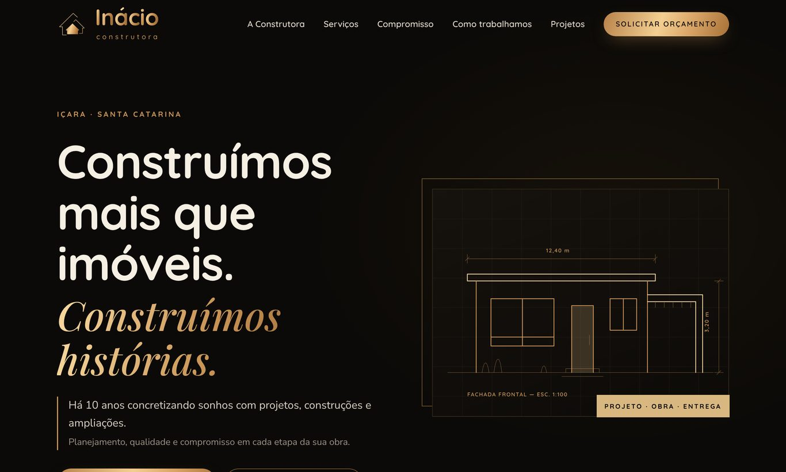

# Inácio Construtora — site

Site institucional de página única da Inácio Construtora (Içara/SC), seguindo o brand kit 2026.

- `index.html`: arquivo único, sem dependências além das fontes do Google Fonts.
- Abertura: o motion original do logo roda e, ao terminar, o logo encolhe e voa até o topo do site.
  Ajuste `MIN_TIME` no script `inacio-loader-js` para encurtar. Clique ou Esc pulam a abertura.
- Formulário de orçamento monta a mensagem e abre o WhatsApp (48) 99838-5215.
- Projetos usam desenhos técnicos em SVG; para usar fotos reais, veja o comentário na seção `#projetos`.

Para publicar: envie o `index.html` para qualquer hospedagem estática (GitHub Pages, Netlify, Vercel, Hostinger).

## Prévia

| Abertura | Logo completo |
|---|---|
|  |  |

[Página inteira (computador)](preview/4-pagina-desktop.jpg)
